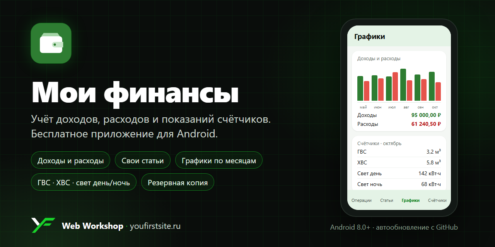

<p align="center">
  
</p>

# Мои финансы

Бесплатное приложение для Android: учёт доходов и расходов, свои статьи, графики по месяцам
и показания счётчиков воды и электричества. Всё хранится только на вашем телефоне — без
регистрации, рекламы и облаков.

**[⬇ Скачать последнюю версию (APK)](https://github.com/vanich79/finance-tracker/releases/latest/download/MoiFinansy.apk)**
· [все версии](https://github.com/vanich79/finance-tracker/releases)

Нужен Android 8.0 или новее. Размер — около 1,5 МБ.

## Возможности

- **Доходы и расходы** — сумма, статья, комментарий, дата. Итоги месяца: доходы, расходы, остаток.
- **Свои статьи** — готовый набор («Продукты», «ЖКХ», «Зарплата»…) можно переименовать, удалить и дополнить.
  По каждой статье видно, сколько ушло за месяц и какая это доля.
- **Графики** — доходы и расходы за 12 месяцев, расход воды и света по месяцам.
- **Счётчики** — ГВС, ХВС и электричество, в том числе **двухтарифный счётчик (день/ночь)**.
  Приложение само считает расход и стоимость по вашему тарифу и одной кнопкой заносит её в расходы.
- **Резервная копия** — все данные в один файл и восстановление из него.
- **Автообновление** — приложение само сообщает о новой версии и ставит её.
- Светлая и тёмная тема, на Android 12+ — цвета из обоев телефона.

## Установка

Приложения нет в Google Play, оно ставится из файла. Это обычный способ для небольших
приложений — Android просто один раз попросит разрешение.

1. **Скачайте файл** [MoiFinansy.apk](https://github.com/vanich79/finance-tracker/releases/latest/download/MoiFinansy.apk)
   прямо на телефоне. Или скачайте на компьютер и перешлите себе — например, в «Избранное» Telegram
   или по USB-кабелю в папку `Download`.
2. **Откройте файл** на телефоне — из уведомления о загрузке, из Telegram или из приложения «Файлы».
3. Android скажет, что установка из этого источника запрещена, и предложит **«Настройки»**.
   Включите **«Разрешить установку из этого источника»** и вернитесь назад.
4. Нажмите **«Установить»**.
5. Если появится предупреждение **Google Play Protect** о неизвестном приложении —
   нажмите «Подробнее» → **«Всё равно установить»**. Так бывает со всеми приложениями не из Google Play.
6. В списке приложений появятся «Мои финансы» с зелёным кошельком.

После установки разрешение из шага 3 можно выключить: «Настройки» Android → «Приложения» →
«Специальный доступ» → «Установка неизвестных приложений».

### Обновление

Раз в сутки при запуске приложение проверяет, нет ли новой версии. Если есть — появится окно
«Доступна версия …» со списком изменений:

1. Нажмите **«Обновить»** — файл скачается.
2. Нажмите **«Установить»** и подтвердите.
3. В первый раз Android попросит разрешить установку из «Мои финансы» — включите,
   вернитесь и нажмите «Установить» ещё раз.

Проверить вручную или отключить автопроверку: меню **⋮ → «Настройки и о приложении» → «Обновления»**.
Можно обновиться и по-старому — скачать новый APK и открыть его: он встанет поверх, данные сохранятся.

> ⚠️ **Не удаляйте приложение перед обновлением** — при удалении Android стирает его данные.
> Если всё же нужно удалить, сначала сохраните резервную копию.

## Как пользоваться

Внизу четыре вкладки, справа вверху — меню **⋮**.

### Операции

Список доходов и расходов за месяц, сгруппированный по дням. Сверху — итоги месяца
и переключатель месяцев (стрелки ← →; нажатие на название месяца возвращает к текущему).

- **Добавить запись** — кнопка «+». Выберите «Расход» или «Доход», введите сумму
  (`1250` или `99,90`), статью, при желании комментарий и дату.
- **Изменить или удалить** — нажмите на запись.
- Фильтр «Все / Расходы / Доходы» — под итогами.
- Новую статью можно создать прямо в окне записи: «Статья» → «Новая статья…».

### Статьи

Ваши статьи расходов и доходов с суммами за выбранный месяц и долей от общего итога.

- **Добавить** — кнопка «+ Статья».
- **Переименовать или удалить** — нажмите на статью. При удалении записи не пропадают,
  а становятся «Без статьи».

### Графики

- **Доходы и расходы** — столбцы за 12 месяцев: зелёные — доходы, красные — расходы.
  Нажмите на столбец — внизу появятся суммы и остаток за этот месяц. Ниже — средние значения.
- **Расход по счётчикам** — выберите ГВС, ХВС или свет: сколько израсходовано в каждом месяце
  и примерная стоимость по текущему тарифу.
- Стрелки сверху сдвигают период.

Расход за месяц — это разница между показаниями этого месяца и предыдущими. Поэтому столбец
появляется со второго ввода показаний.

### Счётчики

1. **Внесите показания** — кнопка «Внести показания»: поля для всех счётчиков сразу и одна дата.
   Пустые поля пропускаются. Под каждым полем видны предыдущие показания, а если новое
   число меньше — приложение предупредит.
2. **Укажите тариф** — на карточке счётчика «Указать тариф» (цена за 1 м³ или 1 кВт·ч).
   После этого на карточке появятся расход и его стоимость.
3. **«В расходы»** — открывает готовую запись в статье «ЖКХ» с посчитанной суммой. Проверьте и сохраните.

**Двухтарифный счётчик света.** Включите переключатель «Двухтарифный счётчик света» под
карточками. Появятся два счётчика — **день (Т1)** и **ночь (Т2)**, у каждого свои показания
и тариф. Прежние показания однотарифного счётчика остаются в истории и на графике.

Нажмите на строку в «Истории показаний», чтобы исправить или удалить её.

### Резервная копия

Данные хранятся только на телефоне, поэтому **сохраняйте копию** — например, раз в месяц
после ввода показаний.

- **Сохранить:** ⋮ → «Сохранить резервную копию» → выберите место. Надёжнее всего — Google Диск
  или «Избранное» в Telegram, а не только память телефона.
- **Восстановить:** ⋮ → «Восстановить из копии» → выберите файл. Приложение покажет, что в файле,
  и только после подтверждения **заменит** текущие данные.

Копия — обычный текстовый файл `finance-backup-ГГГГ-ММ-ДД.json`. В нём все записи, статьи,
показания, тарифы и настройки. Копию можно перенести на новый телефон.

### Настройки и о приложении

⋮ → «Настройки и о приложении»: версия приложения, обновления, резервная копия,
сайт разработчика, исходный код и кнопка «Помочь разработчику».

## Конфиденциальность

- Все записи хранятся **только на телефоне**, в памяти приложения. Регистрации и аккаунтов нет.
- В интернет приложение выходит **только** чтобы спросить у GitHub, нет ли новой версии,
  и скачать её. Ваши данные при этом никуда не отправляются. Автопроверку можно выключить в настройках.
- Разрешения:
  - **Интернет** — для проверки и скачивания обновлений;
  - **Установка приложений** — чтобы передать скачанное обновление установщику Android.
    Ставит обновление всё равно сам Android и только после вашего подтверждения.

## Частые вопросы

**«Приложение не установлено» при обновлении.** Версия в файле не новее установленной,
или файл собран не из этого репозитория (у него другая подпись). Скачайте APK со
[страницы релизов](https://github.com/vanich79/finance-tracker/releases).

**Пропали данные.** Данные стираются только при удалении приложения или очистке его данных
в настройках Android. Восстановите их из резервной копии.

**Новый телефон.** Сохраните копию на старом телефоне, установите приложение на новом
и восстановите из копии.

## Для разработчиков

Kotlin, Jetpack Compose (Material 3), SQLite через `SQLiteOpenHelper`. Сторонних библиотек,
кроме AndroidX, нет. Графики нарисованы на `Canvas`.

```
app/src/main/kotlin/ru/homefinance/
├─ data/   база (Repository), модели, резервная копия, статистика, обновления
└─ ui/     экраны: операции, статьи, графики, счётчики, настройки
```

Сборка: нужны JDK 21 и Android SDK 35.

```bash
./gradlew testDebugUnitTest   # тесты (Robolectric): миграции, копия, расчёты, обновления
./gradlew assembleRelease     # app/build/outputs/apk/release/app-release.apk
```

Своя сборка подписывается вашим ключом, поэтому поверх версии из релизов она не встанет —
сначала удалите приложение (сохранив копию).

**Выпуск новой версии:**
1. Увеличьте `versionCode` и `versionName` в `app/build.gradle.kts`.
2. Если меняется база — поднимите версию в `FinanceDb` и добавьте шаг в `onUpgrade`:
   у пользователей уже есть данные.
3. Соберите APK и создайте релиз с тегом `vX.Y`, приложив файл под именем `MoiFinansy.apk`:
   ```bash
   gh release create v1.4 MoiFinansy.apk --title "Мои финансы 1.4" --notes "Что нового: …"
   ```
   Установленные приложения увидят релиз при следующей автопроверке.

## Поддержать проект

Приложение бесплатное. Если оно вам пригодилось — можно [помочь разработчику](https://dalink.to/vanich79) 💚

Разработка — **[Web Workshop](https://youfirstsite.ru)**: сайты, Telegram-боты и приложения под ключ.
